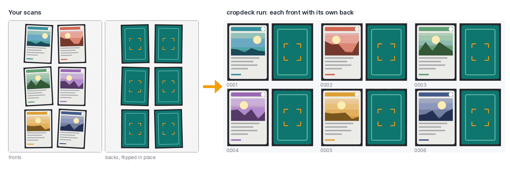

<h1>
  <picture>
    <source media="(prefers-color-scheme: dark)" srcset="cropdeck/ui/static/img/logo-dark.svg">
    
  </picture>
</h1>

**True-scale scans of trading cards, front and back paired.** Lay eight cards on a flatbed
scanner, scan them, flip each one where it lies, scan again - cropdeck cuts every card out
upright and at its real size, and puts each front next to its own back.

<picture>
  <source media="(prefers-color-scheme: dark)" srcset="docs/assets/demo-dark.png">
  
</picture>

<sub>Synthetic cards drawn by <code>tools/demo_image.py</code>; the right-hand side is real cropdeck output.</sub>

## Why

A scanner's "auto crop" cuts trading cards short, trims holo cards whose edges reflect, and knows
nothing about fronts and backs. Phone apps identify a card and throw the picture away. And with a
stack of cards whose backs all look the same, a front saved with the wrong back is invisible - and
cannot be undone.

cropdeck uses the scanner for one thing only - an uncropped image of the whole glass - and does
the rest where it can be checked:

- **A front stays with its own back.** Pairing is by where each card lay on the glass, checked
  several ways. If a tray does not add up, cropdeck refuses it and writes nothing, rather than
  guess.
- **True scale.** Cards are rotated and cut out, never stretched: 63 × 88 mm plus a 1 mm margin,
  the same for every card.
- **Offline, no account.** Your scans never leave your computer.

## Install

You need Python 3.10 or newer. On Linux and macOS, install it into a virtual environment of its
own (Ubuntu: `sudo apt install python3-venv` first):

```bash
python3 -m venv ~/cropdeck-env
source ~/cropdeck-env/bin/activate
pip install "cropdeck[all] @ https://github.com/AnotherToaster/cropdeck/archive/refs/heads/main.zip"
```

In a new terminal, `source ~/cropdeck-env/bin/activate` again before using `cropdeck`. (A plain
`pip install` outside one fails on Ubuntu: 24.04 refuses it, and 22.04's own pip builds cropdeck
as "unknown".)

**On Windows**, follow [docs/install-windows.md](docs/install-windows.md) - Python, cropdeck and
Tesseract step by step, tested on Windows.

Cropping and pairing need nothing else. `[all]` adds the two optional steps below; reading names
also needs the [Tesseract](https://github.com/tesseract-ocr/tesseract) engine
(`sudo apt install tesseract-ocr`, `brew install tesseract`, or the Windows installer).

## Use

### In the browser

```bash
cropdeck ui
```

The interface opens in your browser; it runs on your computer only and needs no internet.

1. **Setup** (first start): choose or make a folder for your cards and pick how the cards lie on
   the glass. cropdeck makes `scans` and `sorted` inside and shows the path to set as your
   scanner's save folder: full glass, no auto-crop, 400 dpi ([docs/scanning.md](docs/scanning.md)).
2. **Scan** a tray: lay the cards, scan, **flip each card where it lies**, scan again. The page
   notices new scans by itself and always shows the next step; then press **Process**. A tray that
   does not add up stops with the reason and the ways to fix it.
3. **Review**: every card, front beside back, with name, number, set, language and variant to
   fill in - keyboard friendly (J/K, Enter, E, Space for true size).

### On the command line

1. Make a folder for your cards with a `scans` folder inside, and set the scanner to save there.
2. Lay **8 cards sideways** - two across, four down, all the same way round - and scan.
3. **Flip each card where it lies** and scan again. Fronts and backs alternate: first scan fronts,
   second scan backs, third scan the next tray's fronts, and so on.
4. Run:

   ```bash
   cropdeck run mycards
   ```

Both give you the same folder:

```
mycards/
  scans/                         your scans - never changed
  sorted/
    card_0001_front.png          the same number = the same physical card
    card_0001_rear.png
    ...
    cards.csv                    one row per card
    _pairs/                      one proof sheet per tray: every front beside its back
```

Run it again whenever you have scanned more: finished scans are skipped and numbering continues.
Other layouts work too - `--expect 6` or `--expect 9` for six or nine cards per scan.

### Optional

```bash
cropdeck run mycards --names      # read each card's name and number (Pokémon, by OCR)
cropdeck run mycards --tracker    # keep a spreadsheet of the collection
```

- **`--names`** reads the name and collector number off each front and puts them into the file
  names (`0001_Pikachu_25-102_front.png`). It knows the printed names of all Pokémon in English,
  German, French, Spanish and Italian. Honest expectations: OCR is good on plain modern cards and
  weaker on holos, V/GX/ex cards, older fonts and Japanese cards - check the result.
- **`--tracker`** keeps `card-tracker.xlsx`: inventory, duplicates and a summary, in English or
  German, in EUR, USD, GBP or CHF. Nothing you type into it is ever overwritten
  ([docs/tracker.md](docs/tracker.md)).

## Which cards

cropdeck is built for **standard-size cards (63 × 88 mm)** in any language. It has been tested on
real scans of Pokémon cards; Magic: The Gathering and other games of the same size should work the
same way, but have not been tried yet - reports welcome. Reading names (`--names`) works for Pokémon
only. Yu-Gi-Oh cards are smaller (59 × 86 mm); support for other sizes is planned.

## Documentation

| | |
|---|---|
| [docs/install-windows.md](docs/install-windows.md) | installing on Windows, step by step |
| [docs/scanning.md](docs/scanning.md) | scanner settings, layouts, the daily loop, troubleshooting |
| [docs/how-it-works.md](docs/how-it-works.md) | every step, why it is built that way, every command and option |
| [docs/tracker.md](docs/tracker.md) | the spreadsheet: sheets, columns, languages and currencies |

## What's next

- Card names in the browser interface (today: `cropdeck run --names` on the command line)
- Collection view and settings
- German interface
- A Windows app: one download, no Python
- Installing from PyPI (`pip install cropdeck`)

## Contributing

Bug reports and pull requests are welcome - see [CONTRIBUTING.md](CONTRIBUTING.md) for setup, tests
and conventions, and [CHANGELOG.md](CHANGELOG.md) for what changed. The tests draw their own
abstract cards, so no card artwork is ever needed. Security problems go privately to
cropdeck@dr-dev.ch ([SECURITY.md](SECURITY.md)).

The repo also ships a [Claude Code](https://claude.com/claude-code) subagent,
[`.claude/agents/cropdeck.md`](.claude/agents/cropdeck.md), that knows the pipeline, its guarantees
and its tests.

## Licence and trademarks

[MIT](LICENSE) © 2026 Dominik Röttger · [dr-dev.ch](https://dr-dev.ch)

The Pokémon name list (`cropdeck/data/pokemon_names.json`) was generated from
[PokéAPI](https://pokeapi.co/) data. Pokémon, Magic: The Gathering, Yu-Gi-Oh! and all card and
character names are trademarks of their owners; cropdeck is not affiliated with or endorsed by
them. No card images are included in this repository.
